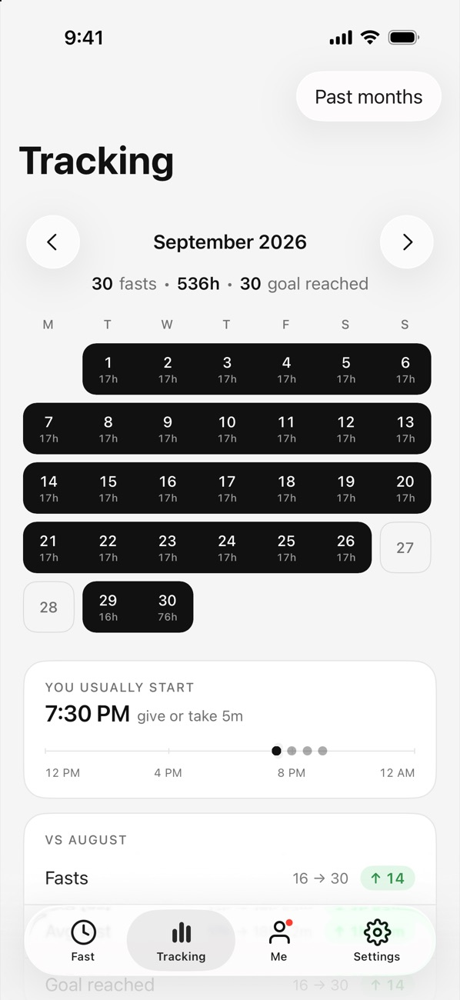

This is the opening paragraph. It sits just under the cover and should say, in two or three sentences, what the reader will get from the article and why it's worth their time. Keep it plain and specific.

## Headings break the article into sections

Each section starts with a heading like the one above. When an article has three or more, a short "In this article" list appears near the top, so readers can jump straight to the part they need.

Paragraphs are set at a comfortable reading size, with room between them. You can use **bold** for the one phrase in a paragraph that matters most, and *italic* for a title or a word you want to stress. Links look [like this](/guides/16-8-intermittent-fasting/).

## Lists, for steps and options

Use a numbered list when order matters:

1. Pick a fasting schedule you can keep.
2. Start the timer when you finish eating.
3. End the fast when you're ready, and look back at your week.

And a bulleted list when it doesn't:

- Water, sparkling water, black coffee and plain tea
- A routine that fits your work and family
- A calendar to look back on

## Notes and quotes

:::note
**A note** stands out from the text. Use it for a tip, a caveat or a short safety reminder that readers shouldn't miss.
:::

> A quote is set larger, for a line from a reader, an expert or a study that deserves its own moment.

## Images, with captions

## Sources, for anything factual

Any claim about health or research gets a small numbered citation, like this one about when the body switches from sugar to fat.[^1] The full source is listed at the bottom of the article, above the medical note.

[^1]: Anton et al., Flipping the metabolic switch: understanding and applying the health benefits of fasting, Obesity, 2018. https://pmc.ncbi.nlm.nih.gov/articles/PMC5783752/
